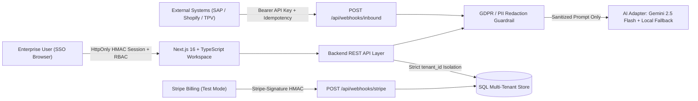

# ResolveDesk AI — Multi-Tenant Enterprise CX & Copilot SaaS

**ResolveDesk AI** is a full-stack, cloud-native **B2B Customer Experience (CX) & AI Triage SaaS Proof-of-Concept**, architected after **Zendesk Suite Enterprise + AI Copilot**.

Built to demonstrate end-to-end **Enterprise SaaS Architecture, Cloud Security, AI Governance (GDPR), Omnichannel APIs, and Hybrid Usage-Based Monetization**—bridging technical solution engineering with C-level ROI business cases (CIO, CISO, CFO, and VP of CX).

---

## Architectural Highlights



### 1. Cryptographic Multi-Tenancy & Role-Based Access Control (RBAC)
* **Zero URL-Parameter Trust:** Tenant isolation (`organization_id`) and role permissions (`ADMIN` vs `AGENT`) are cryptographically signed with **HMAC-SHA256** inside an `HttpOnly` session cookie ([`src/lib/auth.ts`](src/lib/auth.ts)) using constant-time signature verification (`crypto.timingSafeEqual`).
* **Database-Level Isolation:** Every SQL query and mutation enforces composite filtering (`WHERE id = ? AND organization_id = ?`) to prevent cross-tenant leakage (IDOR), backed by composite tenant indexes.
* **Server-Enforced RBAC (`HTTP 403 Forbidden`):** Support `AGENT` seats can triage and resolve tickets, while sensitive operations (API key viewing/rotation, ticket deletion, and Stripe subscription upgrades) are strictly restricted to `ADMIN` roles.

### 2. European AI Governance — GDPR / PII Redaction Guardrail
* Addresses the #1 European CISO/DPO objection to enterprise AI adoption: **sensitive customer data never leaves the perimeter unmasked**.
* Before invoking any external LLM, [`src/lib/pii-guardrail.ts`](src/lib/pii-guardrail.ts) intercepts and masks **IBANs, payment card digits, national IDs (DNI/NIE/NIF), emails, and phone numbers**, storing an auditable PII interception report per ticket and exposing a live **Agent View vs. Sanitized LLM Prompt** toggle.

### 3. Resilient AI Engine (`Google Gemini 2.5 Flash` + Graceful Local Fallback)
* Implements the **Cloud Provider Adapter + Circuit-Breaker Fallback** pattern ([`src/lib/ai-triage.ts`](src/lib/ai-triage.ts)).
* Dynamically routes structured JSON triage requests (*Intent*, *Customer Sentiment / Churn Risk*, *SLA Priority*, *Executive Summary*, and *Agent Copilot Reply Draft*) to **Google Gemini 2.5 Flash**, while seamlessly failing over to a deterministic local NLP engine if no API key is configured or during upstream cloud outages.

### 4. Machine-to-Machine Omnichannel Webhooks & Idempotency
* [`POST /api/webhooks/inbound`](src/app/api/webhooks/inbound/route.ts) authenticates external enterprise systems (SAP S/4HANA, Shopify, payment gateways) via per-tenant `Bearer` API keys (`zd_live_...`).
* **Idempotent Event Processing:** Deduplicates retries via `external_event_id` (`HTTP 200 IDEMPOTENT_SKIP`), guaranteeing zero duplicate tickets and zero double-billing of AI resolutions during network retries.

### 5. Hybrid SaaS Monetization (Stripe Billing + MEDDPICC ROI Modeler)
* Models modern CX SaaS packaging: **Recurring Seat Licenses (MRR/ARR)** + **Outcome/Usage Quotas (*Automated Resolutions*)**.
* Enforces `HTTP 402 Payment Required` when a Starter tenant exhausts its monthly AI resolution allowance, unlocking capacity asynchronously via HMAC-verified **Stripe Webhooks** ([`POST /api/webhooks/stripe`](src/app/api/webhooks/stripe/route.ts)).
* Includes a live **CFO / VP CX Value Calculator** modeling net annual savings, Average Handle Time (*AHT*) reduction, First Reply Time (*FRT*), and payback period.

---

## Tech Stack

* **Application & API:** Next.js 16 (App Router, Standalone Cloud Output), React 19, TypeScript 5, Tailwind CSS 4
* **Database:** Native Node.js SQLite (`node:sqlite` WAL mode) — zero external daemon required locally, portable to Cloud SQL / PostgreSQL
* **Security & Billing Protocols:** Node `crypto` HMAC-SHA256 (`HttpOnly` SSO sessions & `Stripe-Signature` verification)
* **AI Layer:** Google Gemini 2.5 Flash REST Structured Outputs + Local High-Availability NLP Fallback
* **Cloud & DevOps:** Multi-stage non-root `Dockerfile` (port `8080` for **Google Cloud Run**), `docker-compose.yml`, and GitHub Actions CI (`.github/workflows/ci.yml`)

---

## Quickstart (Local Development)

Requires **Node.js v22.5+ / v24+** (uses built-in `node:sqlite`).

```bash
# 1. Install dependencies
npm install

# 2. Optional: configure secrets or Gemini API Key
cp .env.example .env.local

# 3. Start local server
npm run dev
```

Open **http://localhost:3000** and sign in with 1 click through the **Enterprise SSO Portal** as either:
* **Moda Ibérica Retail (`ENTERPRISE` · €4,800 MRR):** Test GDPR PII redaction, Agent Copilot, and SAP ERP webhooks.
* **PayFlow Digital (`STARTER` · €190 MRR):** Experience `HTTP 402` AI quota exhaustion, RBAC `HTTP 403` enforcement, and live Stripe Checkout upgrades.

---

## Deploying to Google Cloud Run

This repository is pre-configured with `output: "standalone"` and a multi-stage, non-root [`Dockerfile`](Dockerfile) listening on `$PORT` (`8080`):

```bash
# Build and deploy directly to Google Cloud Run (Europe-Southwest1 / Madrid)
gcloud run deploy resolvedesk-ai \
  --source . \
  --region europe-southwest1 \
  --allow-unauthenticated \
  --set-env-vars="NODE_ENV=production"
```

---

## Author

**Enrique García** — Enterprise Account Executive  
[LinkedIn](https://linkedin.com/in/enriquegarciacollado) • [GitHub Portfolio](https://github.com/egarcia-enterprise)
